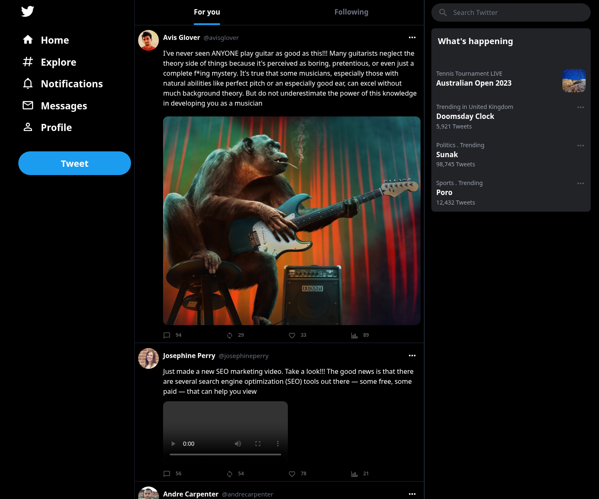
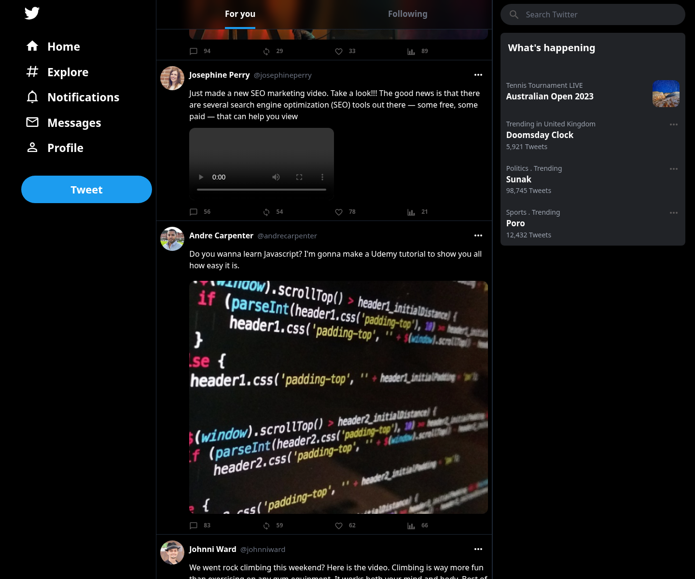

# Homa — Twitter Clone

**Homa** is a lightweight **clone of Twitter (X)**: a dark-themed social feed where you can browse posts, compose new tweets with media, and delete posts — built as a clean portfolio / demo app.

> No authentication required. Open the home page and use the feed immediately.

**Live demo:** [https://cafejoon.ir/twitter](https://cafejoon.ir/twitter)

---

## Screenshots

| Home feed | Scrolled feed |
|-----------|---------------|
|  |  |

---

## Features

| Feature | Description |
|---------|-------------|
| **Public timeline** | Seeded tweets with avatars, handles, engagement counts, and optional images |
| **Compose tweet** | Modal composer (text + optional image or MP4) |
| **Delete tweet** | Remove a post from the overflow menu |
| **Twitter-style UI** | Left nav, “For you” header, search, and “What’s happening” sidebar |

This project intentionally stays focused: a working Twitter-clone surface, not a full social network.

---

## Tech stack

| Layer | Technology |
|-------|------------|
| Backend | PHP 8.2+, Laravel 11 |
| Frontend | Vue 3, Inertia.js, Tailwind CSS |
| Tooling | Vite, Ziggy |
| Data | SQLite (local default) or MySQL |
| Deploy | Docker Compose (subdirectory-friendly) |

---

## Requirements

- PHP 8.2+ with extensions required by Laravel
- Composer
- Node.js 18+ and npm
- SQLite **or** MySQL 8

---

## Quick start (local)

```bash
git clone <your-repo-url> homa
cd homa

cp .env.example .env
composer install
php artisan key:generate

# SQLite (default)
touch database/database.sqlite
php artisan migrate --seed

npm install
npm run dev
# In another terminal:
php artisan serve
```

Visit [http://127.0.0.1:8000](http://127.0.0.1:8000).

**Production-style local assets:**

```bash
npm run build
php artisan serve
```

### MySQL instead of SQLite

In `.env`:

```env
DB_CONNECTION=mysql
DB_HOST=127.0.0.1
DB_PORT=3306
DB_DATABASE=homa
DB_USERNAME=homa
DB_PASSWORD=secret
```

Then run `php artisan migrate --seed`.

---

## Project structure

```text
app/Http/Controllers/TweetController.php   # Feed, create, delete
app/Models/Tweet.php
database/seeders/TweetsSeeder.php          # Sample timeline data
resources/js/Pages/Welcome.vue             # Home feed
resources/js/Layouts/BaseLayout.vue        # Shell (nav + sidebar)
resources/js/Components/Tweet/             # Tweet card + composer
routes/web.php                             # Public demo routes
public/pics/                               # Seeded / uploaded images
docs/portfolio/                            # Screenshots
docker-compose.yml                         # Container deploy
```

### Routes

| Method | Path | Name | Action |
|--------|------|------|--------|
| `GET` | `/` | `dashboard` | Timeline |
| `POST` | `/tweets` | `tweets.store` | Create tweet |
| `DELETE` | `/tweets/{tweet}` | `tweets.destroy` | Delete tweet |

---

## Environment notes

| Variable | Purpose |
|----------|---------|
| `APP_URL` | App root URL (used for redirects & Ziggy) |
| `ASSET_URL` | Optional CDN / subdirectory asset root |
| `VITE_BASE` | Vite public base path at **build** time |

For a **subdirectory** deploy (example: `/twitter`):

```env
APP_URL=https://example.com/twitter
ASSET_URL=https://example.com/twitter
```

Build assets with the matching Vite base:

```bash
npm run build:cafejoon
# equivalent to: VITE_BASE=/twitter/build/ vite build
```

`AppServiceProvider` forces HTTPS and root URL from `APP_URL` when configured. Proxies are trusted so scheme/host work behind nginx.

---

## Docker deploy (Cafejoon / `/twitter`)

This repo includes a Compose file aimed at the Cafejoon stack (`sail-8.3/app-prod`, external network `cafejoon_app`).

```bash
# On the server (after syncing the repo)
cp .env.example .env   # or your deploy env file
# Set APP_KEY, APP_URL, ASSET_URL, DB_* for MySQL in Compose

composer install --no-dev --optimize-autoloader
php artisan migrate --force --seed
npm ci
npm run build:cafejoon
docker compose up -d
```

Point nginx so `/twitter/` proxies to the `homa_app` container (strip prefix as needed).

---

## Scripts

| Command | Description |
|---------|-------------|
| `npm run dev` | Vite HMR for local development |
| `npm run build` | Production assets (`/build/...`) |
| `npm run build:cafejoon` | Production assets under `/twitter/build/...` |
| `php artisan migrate --seed` | Schema + sample tweets |
| `php artisan serve` | Local PHP server |

---

## License

MIT
